<p align="center">
  
</p>

  

A hands-on comparison of Android's **background** and **foreground services**. The foreground service plays music with Start / Pause / Stop controls and keeps playing after you leave the app — exactly the situation where Android requires a visible notification.

## Features

- **ForegroundService** playing a bundled track with `MediaPlayer`
- **Start / Pause / Stop** buttons sending commands to the running service
- **Notification channel** created for Android 8+, with `startForeground()`
- **BackgroundService** that logs from a worker thread every second, to observe its lifecycle in Logcat

## How it works

The activity doesn't bind to the service — it sends commands through the `Intent` that starts it:

```kotlin
Intent(this, ForegroundService::class.java).apply {
    putExtra("code", code)          // 0 = play, 1 = pause/resume, else = stop
    startForegroundService(this)
}
```

In `onStartCommand`, the service reads the code and acts on its `MediaPlayer`; anything other than 0 or 1 calls `stopSelf()`, which releases the player in `onDestroy()`.

## Project structure

```
com.example.serviceexample
├── BackgroundService.kt
├── ForegroundService.kt
└── MainActivity.kt
```

<sub>3 source files · 131 lines of code · 1 layout</sub>

## Tech stack

| | |
|---|---|
| **Language** | Kotlin |
| **UI** | XML layouts |
| **Min / Target SDK** | 24 / 34 |

## Getting started

```bash
git clone https://github.com/rajabbov/ServiceExample.git
```

1. Open the folder in **Android Studio** (Ladybug or newer).
2. Let Gradle sync.
3. Run the `app` configuration on a device or emulator.

## Known limitations

- On Android 13+ the notification also needs the `POST_NOTIFICATIONS` runtime permission to be visible.

---

Made by **Ibrohimjon Rajabboyev** · [@rajabbov](https://github.com/rajabbov)
